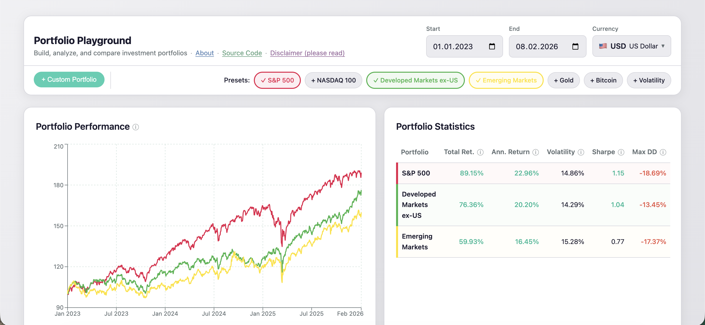
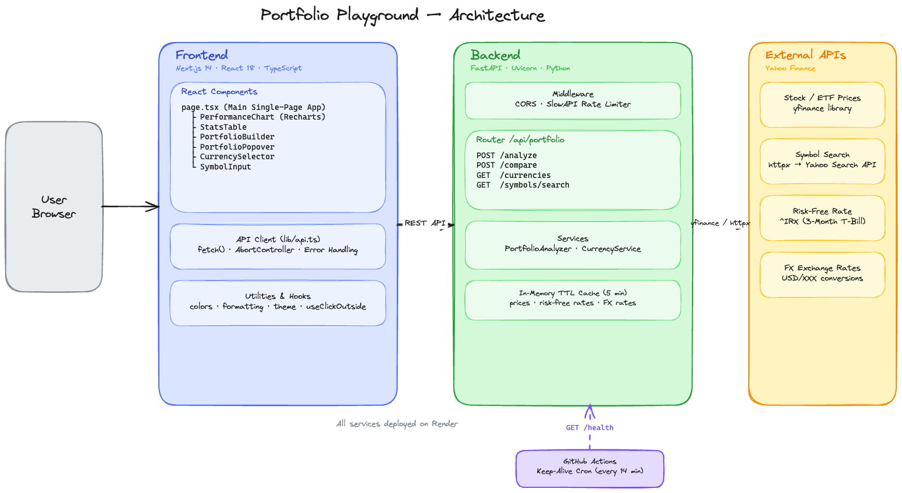

# Portfolio Playground

A web application for analyzing and comparing investment portfolio performance. Build custom portfolios from real market data, visualize historical returns, and compare key risk/return metrics side by side. See [this blog post](https://jianchao.xyz/projects/portfolio-playground/) for an introduction and demo video.



## Features

- **Portfolio builder** -- Create custom portfolios by searching for ticker symbols and assigning weights. Includes autocomplete search powered by Yahoo Finance.
- **Preset portfolios** -- Quickly add common benchmarks: S&P 500 (VOO), NASDAQ 100 (QQQ), Developed Markets (VEA), Emerging Markets (VWO), Gold (GLD), Bitcoin (IBIT), and Volatility (VIXY).
- **Performance chart** -- Compare portfolios on a normalized $100-start line chart over a configurable date range.
- **Statistics table** -- Side-by-side comparison of Total Return, Annualized Return, Volatility, Sharpe Ratio, and Max Drawdown, with tooltips explaining each metric.
- **Multi-currency support** -- View results in 40 currencies (USD, EUR, GBP, JPY, CNY, and more) using real-time exchange rates.
- **Asset allocation view** -- Hover over any portfolio to see a pie chart breakdown of its holdings.

## Architecture



**Frontend** (`frontend/`) -- Next.js 14 with React 18 and TypeScript. The page (`page.tsx`) is a server component that prefetches the default portfolios and is regenerated hourly (ISR), so the first paint already contains data. The interactive app (`PortfolioPlayground.tsx`) orchestrates several components:
- `PerformanceChart` (Recharts) -- Normalized line chart comparing portfolio performance
- `StatsTable` -- Side-by-side financial metrics comparison
- `PortfolioBuilder` / `PortfolioPopover` -- Portfolio construction and asset allocation views
- `CurrencySelector` / `SymbolInput` -- Currency picker and ticker autocomplete search

The API client (`lib/api.ts`) handles all backend communication with `fetch()`, `AbortController` for request cancellation, and error handling. Shared utilities include color schemes, formatting helpers, theme configuration, and custom hooks like `useClickOutside`.

**Backend** (`backend/`) -- FastAPI server running on Uvicorn with the following layers:
- *Middleware* -- CORS support, gzip compression, and SlowAPI rate limiting
- *Router* (`/api/portfolio`) -- `POST /analyze`, `POST /compare`, `GET /currencies` (mirrored by the frontend's bundled list), `GET /symbols/search`
- *Services* -- `PortfolioAnalyzer` computes returns and metrics with pandas; `CurrencyService` handles FX conversions
- *Cache* -- In-memory, per-symbol cache of full daily price histories (assets, the ^IRX T-bill series and FX pairs), sliced to each request's date range, so other ranges and symbol combinations only download symbols not seen yet. Data for ranges ending today is re-checked every 5 min (only the last few weeks are downloaded); if Yahoo has re-adjusted past prices (dividends, splits) the symbol's full history is downloaded again. Full histories are refreshed every 6 h; at most 64 symbols are kept (LRU).

**External APIs** (Yahoo Finance) -- The backend fetches data via:
- `yfinance` library -- Stock/ETF historical prices
- `httpx` -- Symbol search via Yahoo Search API
- `^IRX` ticker -- 3-month T-bill index for risk-free rate
- Currency pairs (e.g., `EURUSD=X`) -- Real-time FX rates

**Keep-Alive** -- A GitHub Actions cron job pings `GET /health` every 14 minutes to prevent Render free-tier cold starts.

## Getting Started

### Prerequisites

- Python 3.11+ for the backend (it uses `typing.Self`; CI runs 3.12)
- Node.js 22.18+ for development and testing: `pnpm test:url` runs TypeScript directly (needs 22.18+), and the smoke tests' `puppeteer-core` needs 22.12+. The built frontend itself only needs Node.js 18.17+ (Next.js 14).
- pnpm 9 (the lockfile is v9; CI uses 9.15.9)
- Google Chrome, only for the browser smoke tests

### Setup

```bash
# Install frontend dependencies
pnpm install

# Set up backend virtual environment
cd backend
python -m venv venv
source venv/bin/activate
pip install -r requirements.txt
cd ..
```

### Run

```bash
# Start both frontend and backend together
pnpm dev
```

Or run them separately:

```bash
# Backend (http://localhost:8000)
cd backend
./venv/bin/python -m uvicorn app.main:app --reload

# Frontend (http://localhost:3000)
cd frontend
npm run dev
```

- Frontend: http://localhost:3000
- Backend API: http://localhost:8000

### Keeping the currency list in sync

The supported currencies are bundled with the frontend (`frontend/src/lib/currencies.json`) so the page makes no request for them on load. The source of truth is `SUPPORTED_CURRENCIES` in `backend/app/services/currency.py`. After changing it, update the JSON and run:

```bash
cd frontend
npm run check:currencies   # fails if the two lists differ (needs python3)
```

### Testing

Everything runs offline: the backend tests mock Yahoo Finance, and the browser smoke tests use a mock backend. CI (`.github/workflows/ci.yml`) runs all of the following on every push to `master` and on pull requests. The frontend checks need Node.js 22.18+.

```bash
# Backend unit/API tests
cd backend
pip install -r requirements-dev.txt
python -m pytest -q

# Frontend static checks and unit tests
cd frontend
pnpm exec tsc --noEmit
pnpm lint
pnpm test:url            # shareable-URL state
pnpm check:currencies    # bundled currency list matches the backend

# Browser smoke tests (production build + mock backend on port 8765, ~10 s)
NEXT_PUBLIC_API_URL=http://127.0.0.1:8765 pnpm build
pnpm test:smoke
```

The smoke tests (`frontend/scripts/smoke.mjs`) cover the analyze-vs-refresh race, rename and name collisions, editing a selected ticker, short date ranges, the empty state, and keyboard/ARIA basics. They drive your installed Google Chrome through `puppeteer-core` (no browser download); set `CHROME_PATH` if Chrome is elsewhere. Note that `pnpm build` overwrites `frontend/.next`, so stop `pnpm dev` first. Failure screenshots go to the system temp directory, or to `SMOKE_ARTIFACTS` if set.

### Environment variables (frontend)

- `NEXT_PUBLIC_API_URL` -- Backend base URL (default `http://localhost:8000`). Its origin also gets a `preconnect` hint.
- `NEXT_PUBLIC_SITE_URL` -- Public site URL used for absolute Open Graph / Twitter image links (default `https://portfolio-playground-frontend.vercel.app`).

## Deployment

The app is deployed using free tiers: frontend on **[Vercel](https://vercel.com)** and backend on **[Render](https://render.com)**. Free-tier limitations include:

- **Render cold starts** -- The backend spins down after inactivity. A GitHub Actions cron job pings the backend every 14 minutes to keep it alive.
- **512 MB memory** -- Render free tier has limited RAM, which constrains cache sizes and concurrent requests.

## Disclaimers

This project and the accompanying [webapp](https://portfolio-playground-frontend.vercel.app/) are for informational and educational purposes only. I am not a professional investor or financial advisor, nor do I claim to be, and use of this project or [webapp](https://portfolio-playground-frontend.vercel.app/) does not create an advisory relationship. Data may be inaccurate, delayed, or incomplete, and I do not accept responsibility for any such inaccuracies. The content reflects my personal research and understanding and should not be interpreted as professional advice. You are solely responsible for your financial decisions — consult a qualified financial professional before making investment decisions.

The [webapp](https://portfolio-playground-frontend.vercel.app/) is deployed using free tiers of [Render](https://render.com/) and [Vercel](https://vercel.com/), so its availability is not guaranteed.